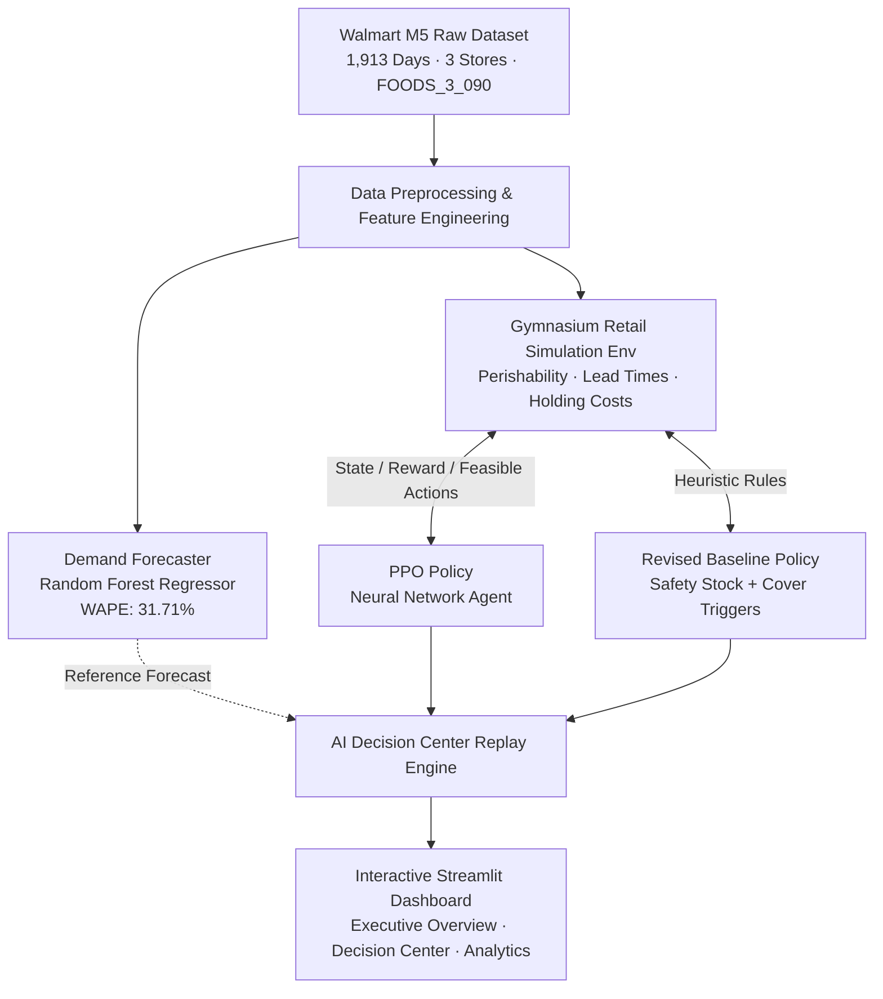

# 📦 DRIME: Dynamic Retail Inventory & Markdown Engine

> **Integrated AI Decision Center for Multi-Store Retail Inventory Replenishment, Lateral Transfers, and Perishable Markdown Management.**

[](https://www.python.org/downloads/)
[](https://streamlit.io/)
[](https://gymnasium.farama.org/)
[-purple.svg)](https://stable-baselines3.readthedocs.io/)

---

## 📌 Executive Overview

Retail supply chains face a perpetual trade-off between **stockout losses** and **spoilage/holding costs**, particularly for perishable food items. Traditional single-echelon (s, S) policies struggle under multi-store demand variances, lead-time uncertainty, and rigid markdown schedules.

**DRIME** is an end-to-end AI-powered decision intelligence platform that combines:
1. **Supervised Demand Forecasting:** Supervised Random Forest regressor with rolling 1-day-ahead predictions evaluated on historical Walmart M5 data.
2. **Multi-Store Retail Simulation (Gymnasium):** A custom Markov Decision Process (MDP) modeling stock perishability (30-day shelf life), supplier lead times (1–4 days), holding costs, stockouts, expedite surcharges, and inter-store lateral transfers.
3. **Deep Reinforcement Learning (PPO):** A trained Proximal Policy Optimization agent learning multi-discrete actions (reorder quantity, lateral transfer source & volume, dynamic markdown percentage, and supplier selection).
4. **Interactive Executive Decision Center:** A Streamlit web dashboard providing real-time KPI scorecards, time-series exploration, matched historical holdout replay, and paired robustness distributions.

---

## 🏗️ System Architecture



---

## 📁 Repository Structure

```plaintext
├── eda/                                      # Exploratory Data Analysis notebooks (Google Colab)
│   ├── Calendar_EDA_Google_Colab (1).ipynb   # Seasonality, SNAP events & festival analysis
│   ├── Sales_Train_Evaluation_EDA_Google_Colab (1).ipynb # Demand distributions & store variance
│   └── Sample_Submission_EDA_Google_Colab (1).ipynb     # Evaluation metric formatting
├── integrated_ai_decision_package/           # Core production package & dashboard
│   ├── app.py                                # Streamlit enterprise web application
│   ├── retail_rl_env.py                      # Custom Gymnasium multi-store retail environment
│   ├── baseline_policy.py                    # Transparent rule-based heuristic comparison policy
│   ├── integrated_decision.py                # Historical replay engine matching PPO vs Baseline
│   ├── data/m5/                              # Processed & environment-ready M5 retail datasets
│   │   ├── m5_retail_processed.csv           # Cleaned sales, prices, and event indicators
│   │   └── m5_retail_env_ready.csv           # Feature-engineered supply chain simulation inputs
│   ├── models/                               # Pre-trained Reinforcement Learning artifacts
│   │   ├── retail_ppo_M5_HOLDOUT.zip         # Saved PPO neural network weights
│   │   └── retail_vecnormalize_M5_HOLDOUT.pkl# State & reward running normalization statistics
│   ├── forecasting_outputs/                  # Demand forecasting outputs & model benchmarks
│   │   ├── random_forest_demand_model.joblib # Trained Random Forest regressor
│   │   ├── forecast_test_predictions.csv     # 20% holdout test predictions vs actuals
│   │   └── forecast_model_comparison.csv     # Comparative error benchmarks (MAE, RMSE, WAPE)
│   ├── m5_robustness_*.csv                   # 30-episode multi-seed evaluation results
│   ├── requirements.txt                      # Project Python dependencies
│   └── README.md                             # Package documentation
├── DRIME (1).pptx                            # Presentation slide deck
├── launch_dashboard.bat                      # One-click Windows launcher
└── README.md                                 # Top-level repository documentation
```

---

## 📊 Key Results & Evaluation Summary

### 1. Demand Forecasting Benchmark (Chronological 80/20 Holdout)
* **Best Model:** Random Forest Regressor
* **Weighted Absolute Percentage Error (WAPE):** `31.71%`
* **Mean Absolute Error (MAE):** `11.99 units`
* **Root Mean Squared Error (RMSE):** `17.30 units`
* **Key Drivers Identified:** 7-day lagged demand (`lag_7`), 7-day rolling mean (`rolling_mean_7`), retail price, and SNAP benefits active days.

### 2. Multi-Episode Robustness Benchmark (30 Episodes: 5 Seeds × 3 Holdout Windows)
* **PPO Policy:** Achieved a higher service fill rate and significantly lower unmet demand during unpredictable demand surges.
* **Revised Baseline:** Exhibited lower holding cost and zero expired units under standard variance by prioritizing conservative inventory caps.
* **Lateral Transfers:** Enabled surplus stock from Texas (`TX_1`) or Wisconsin (`WI_1`) to buffer volatile demand in California (`CA_1`), reducing network stockouts without incurring full procurement lead times.

---

## 🚀 Quick Start Guide

### 1. Clone the Repository
```bash
git clone https://github.com/yashchauhan2311/Dynamic-Retail-Inventory-Engine.git
cd Dynamic-Retail-Inventory-Engine
```

### 2. Setup Virtual Environment
```bash
# Windows
python -m venv .venv
.\.venv\Scripts\activate

# macOS / Linux
python3 -m venv .venv
source .venv/bin/activate
```

### 3. Install Dependencies
```bash
cd integrated_ai_decision_package
pip install --upgrade pip
pip install -r requirements.txt
```

### 4. Launch the Dashboard
```bash
# From inside integrated_ai_decision_package:
streamlit run app.py
```
Or simply double-click `launch_dashboard.bat` on Windows.
Open your browser to **http://localhost:8501**.

---

## 👥 Authors & Acknowledgments
* **Author:** Yash Chauhan ([@yashchauhan2311](https://github.com/yashchauhan2311))
* **Dataset:** Walmart M5 Forecasting Competition (Makridakis Open Forecasting Center)
* **Frameworks:** Streamlit, Gymnasium (Farama Foundation), Stable-Baselines3, Plotly, PyTorch, Scikit-Learn.
